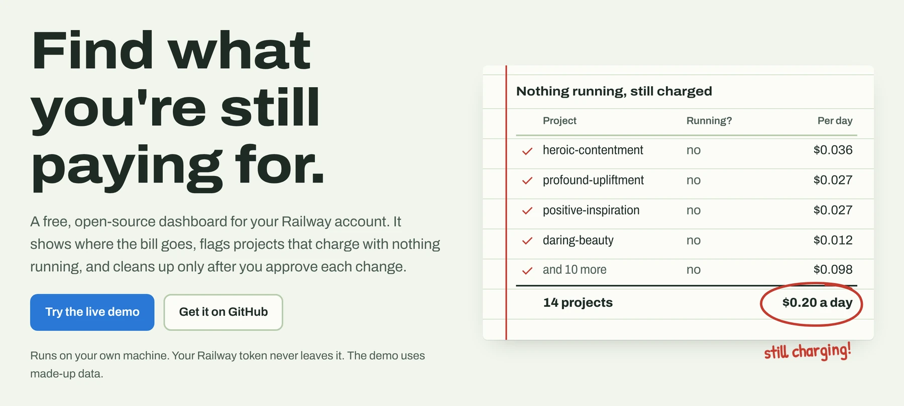
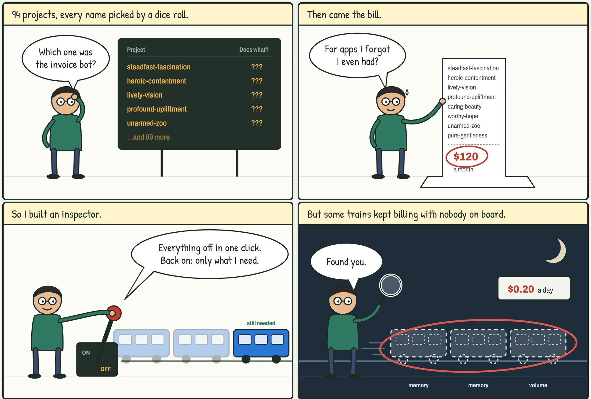
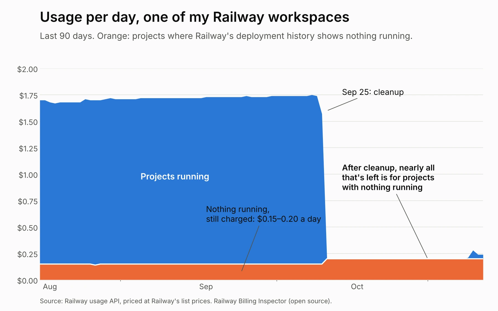
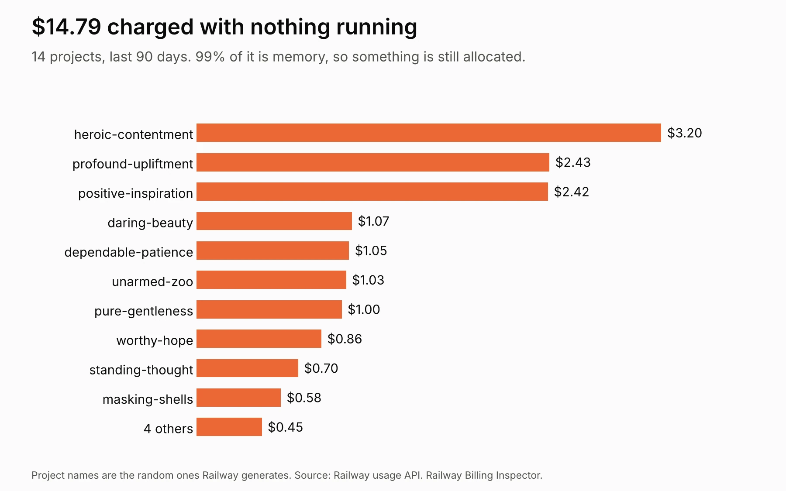
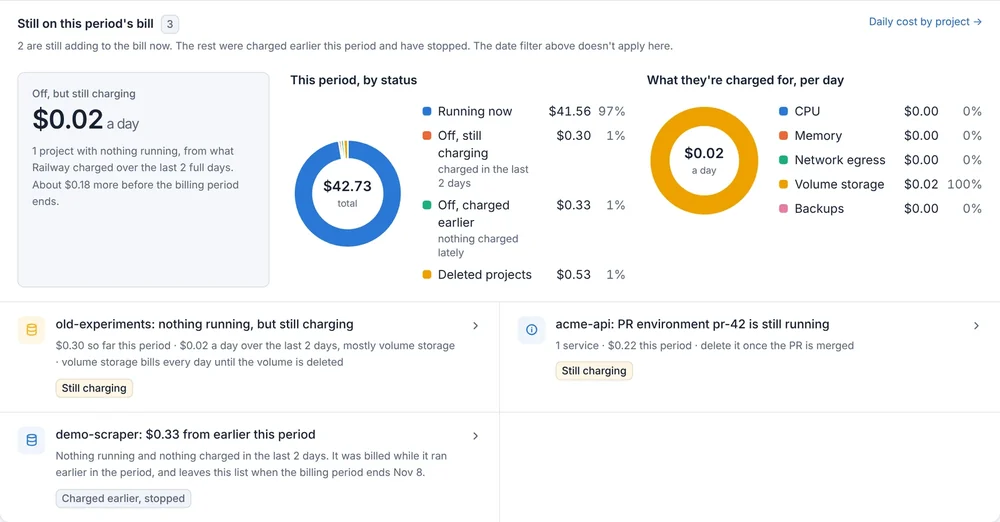
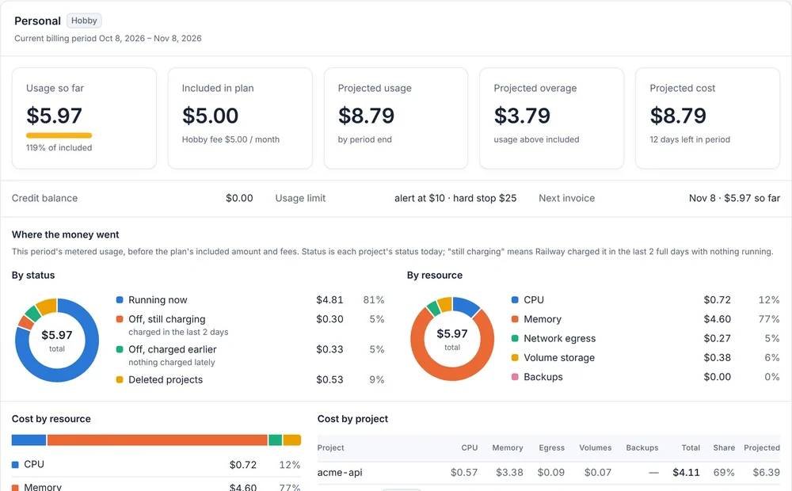
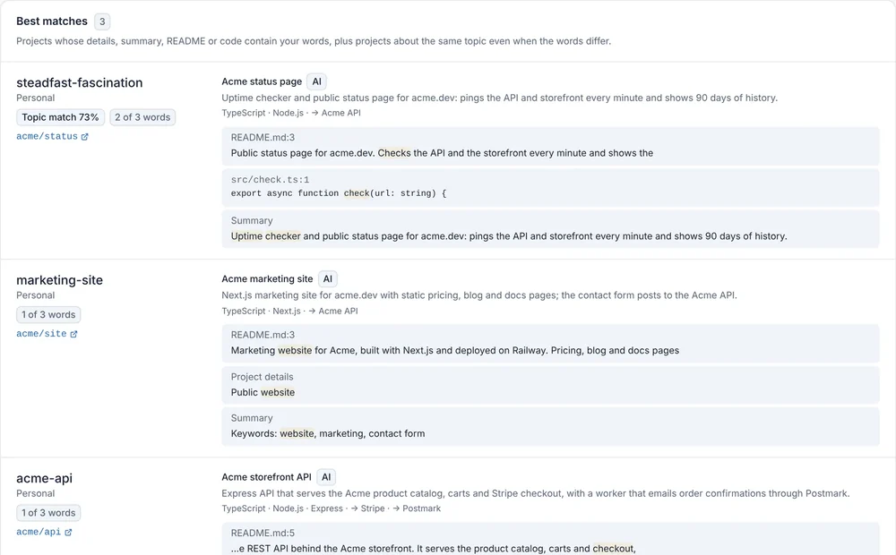
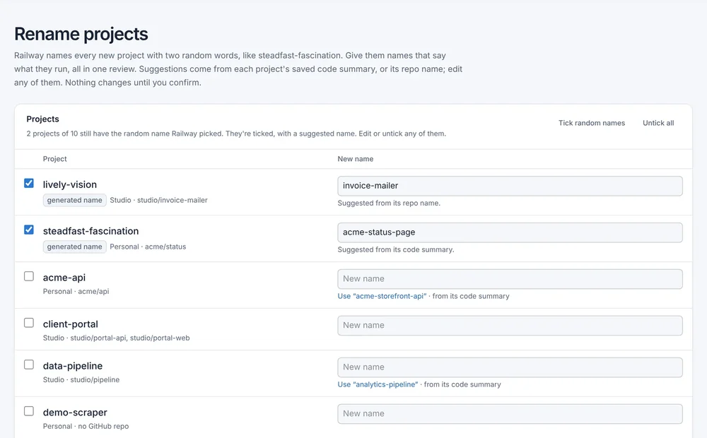
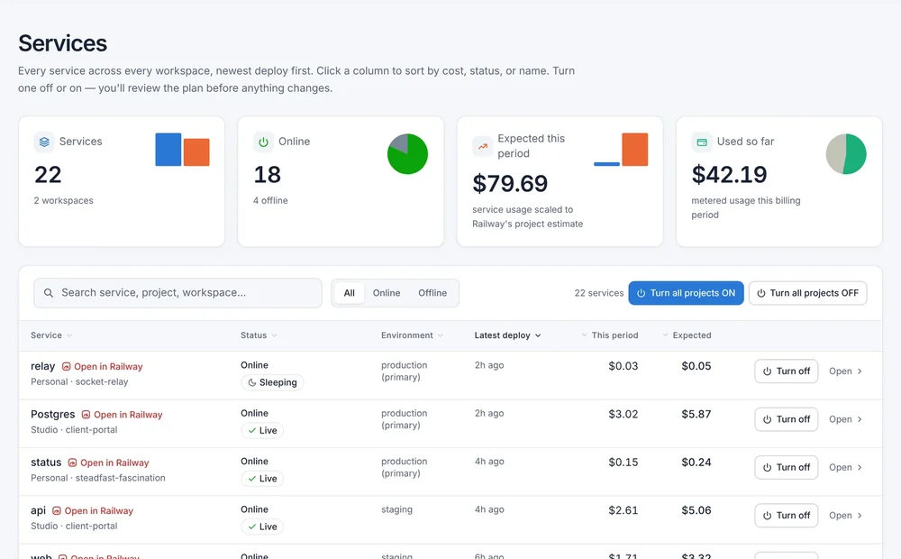
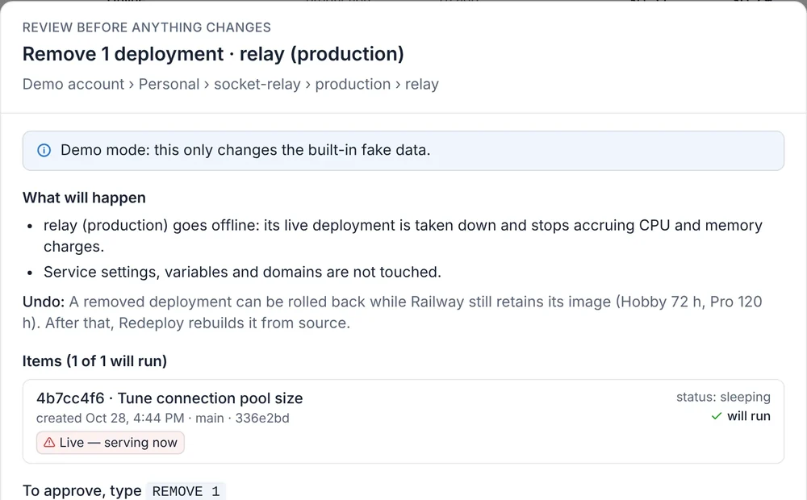

<p align="center">
  <a href="https://railway-billing-inspector.vercel.app/tour.html">
    
  </a>
</p>

<p align="center">
  <a href="https://railway-billing-inspector.vercel.app/tour.html"><b>Take the tour</b></a>
  &nbsp;&nbsp;|&nbsp;&nbsp;
  <a href="https://railway-billing-inspector.vercel.app"><b>Try the live demo</b></a>
  &nbsp;&nbsp;|&nbsp;&nbsp;
  <a href="#run-it-in-five-minutes"><b>Run it on your account</b></a>
  &nbsp;&nbsp;|&nbsp;&nbsp;
  <a href="docs/GUIDE.md"><b>Full guide</b></a>
</p>

<p align="center">
  
  
  
</p>

**Railway Billing Inspector** is a free, open-source dashboard for your [Railway](https://railway.com) account. It shows where the bill goes, flags projects that charge with nothing running, finds any project by what it does, and cleans up only after you approve each change. It runs on your own machine; your token never leaves it.

## The short version

<a href="https://railway-billing-inspector.vercel.app/tour.html#story"></a>

## What it found in one of my workspaces

After the cleanup on September 25, nearly all of what this workspace still cost each day was for projects whose deployment history shows nothing running.

| **$14.79** | **14** | **99%** | **$0.20** |
|:--|:--|:--|:--|
| charged with nothing running, in 90 days | projects | of it for memory | a day since the cleanup |

<p>
  
  
</p>

These are real numbers from one of my Railway workspaces. I run several Railway accounts and a few on Vercel, so they're a slice of my hosting bill, not all of it.

**Run it on yours and tell me what you find:** the charge, the cause, and how you fixed it. [Open an issue](https://github.com/sas70/railway-billing-inspector/issues/new) and I'll collect what people find.

## What you get

<table>
  <tr>
    <td width="50%" valign="top">
      
      <br><b>Off, but still charging.</b> What Railway actually charged each project over the last two days, so a project with nothing running that still costs money says so, with the reason.
    </td>
    <td width="50%" valign="top">
      
      <br><b>Where the money went.</b> Usage against what your plan includes, the projected bill, and the cost by status and by resource, for this period and the last.
    </td>
  </tr>
  <tr>
    <td valign="top">
      
      <br><b>Search by topic.</b> Find a project by what it does. An index on your machine covers summaries, READMEs and code, and topic search finds the right project even when your words differ.
    </td>
    <td valign="top">
      
      <br><b>Rename projects.</b> Swap Railway's random names like <code>steadfast-fascination</code> for names that say what each app does, several at once.
    </td>
  </tr>
  <tr>
    <td valign="top">
      
      <br><b>Every service, one table.</b> Sort by cost, filter to what's online, and turn things off in bulk.
    </td>
    <td valign="top">
      
      <br><b>Nothing changes until you approve it.</b> Review, type the phrase, re-checked on Railway right before it runs, then logged. It starts read-only.
    </td>
  </tr>
</table>

## Run it in five minutes

You need Node.js 20.9 or newer and a Railway account token.

```bash
git clone https://github.com/sas70/railway-billing-inspector.git
cd railway-billing-inspector && npm install
cp .env.example .env.local      # then paste your token after RAILWAY_TOKEN_MAIN=
npm run app                     # open http://127.0.0.1:3100
```

Create the token at [railway.com/account/tokens](https://railway.com/account/tokens) and choose **No workspace**, so one token reads all your workspaces. To look around with no token at all, run `npm run demo`.

## Learn more

- **[Full guide](docs/GUIDE.md):** every page, how approvals work, how the numbers are calculated, the search index, security, and the project layout.
- **[Changelog](CHANGELOG.md):** what's new in each version.
- **[Roadmap](https://railway-billing-inspector.vercel.app/roadmap.html):** what's coming next. Vote, comment or suggest a feature.
- **[License](LICENSE):** MIT.

Made by [sas70](https://github.com/sas70).
