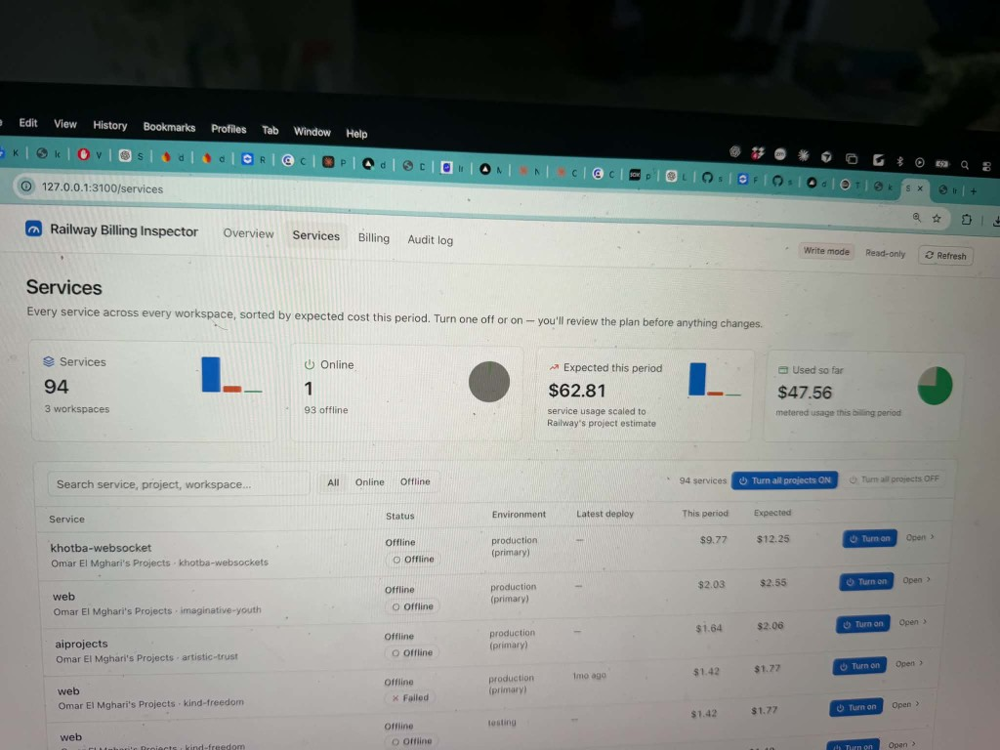
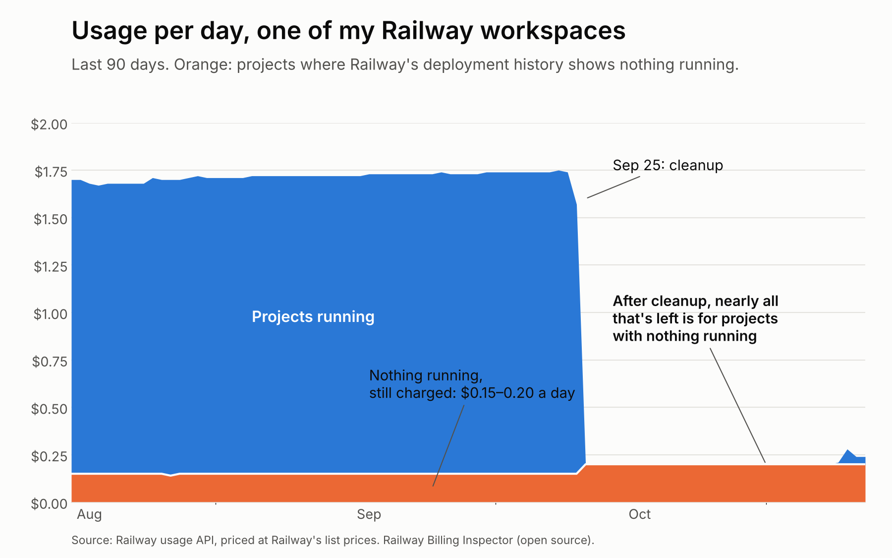
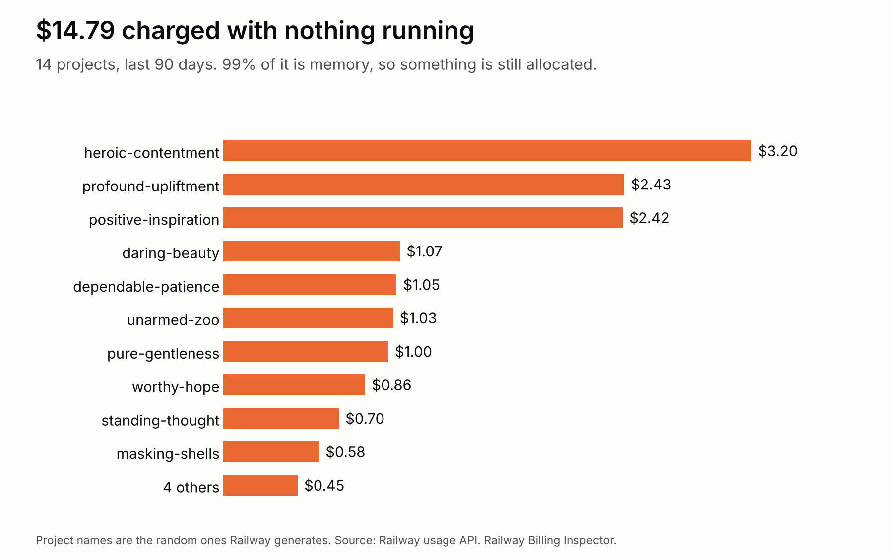

# Railway Billing Inspector

A local Next.js dashboard for your Railway account(s). See every project and its status across your Hobby and Pro workspaces, drill down to services and deployments, check usage and billing, and clean things up. Nothing changes until you have reviewed and approved it.

**See it in action:** [railway-billing-inspector.vercel.app](https://railway-billing-inspector.vercel.app) — demo data only, nothing is sent to Railway. For your own account, run it locally with a token (below).

**New in 0.2.0:** projects that are off but still charging, a bill summary by status and resource, a bulk rename table, and tabs that stay loaded. See the [changelog](CHANGELOG.md).

**What's next:** see the [roadmap](ROADMAP.md), or the [interactive roadmap](https://railway-billing-inspector.vercel.app/roadmap.html) to vote, comment and suggest features.

## Why I built this

I was looking at my recent Railway bills — almost **$120 a month** across **94 projects**. Not all of them needed to be running every day. Taking them down one by one in Railway's own dashboard was a painful process, so I used Claude and Cursor to build this Next.js app.

With it I took every project offline in one click, then turned back on only the ones I still needed.



These numbers come from one of my Railway accounts. I run several Railway accounts and a few on Vercel, so this is a slice of what I spend on hosting, not the whole of it.

### What I found after the cleanup

The cleanup on September 25 took that workspace from about $1.74 of usage a day to $0.20. But nearly all of the $0.20 left was for projects with nothing running. Over the 90 days to October 26, Railway charged **$14.79 of usage** for **14 projects** whose deployment history shows nothing running, 99% of it for memory. That's small, and on a plan whose fee covers its included usage it may not add to the invoice, but it shows up every day and it's easy to miss in Railway's own dashboard. Version 0.2.0 flags these projects as **Off, but still charging**.





Run it on your account and tell me what you find, and what the cause turned out to be: [open an issue](https://github.com/sas70/railway-billing-inspector/issues/new) or reply on my LinkedIn post.

- **Overview.** Every workspace and project with live, crashed, failed and sleeping counts, cost this period, projected cost, and a "Worth a look" list: crashed services, failed deploys, forgotten PR environments, and projects with nothing live that still cost money. Pick **Today / This week / This month / This year / All** to see only recent crashes and failed deploys (This week by default, remembered per browser). Below them, **Still on this period's bill** lists PR environments still running and projects with nothing running that have charges this billing period, whatever the date filter. Each one says whether it is **still charging** (Railway charged it in the last 2 full days with nothing running, usually an attached volume; with the cost per day) or was **charged earlier and stopped** (it drops off when the period ends), with a link to daily cost by project. Above that list, a summary shows what projects with nothing running cost per day (and roughly by period end), this period's cost by status, and what those projects are charged for (CPU, memory, egress or volume storage), so you can see why before opening each one. Search covers every workspace and account (name, domain, service, project ID). Under each project name: the public `*.up.railway.app` (or custom) domain, then a red **Open in Railway** link to `https://railway.com/project/<id>` so you can jump straight into Railway's dashboard. **Rename** sits under that. Names that look like the random two-word ones Railway picks, such as `steadfast-fascination`, are marked **generated name**; enable Write mode, type a clearer name, then review and approve. To rename several at once, open **Rename projects** (see [below](#rename-several-projects-at-once)). **Hover over a project name** to see what its code does: the saved Claude summary when there is one, otherwise the README of your local clone. These cards read local files only, so a repo that is only on GitHub shows one once it has been summarized.
- **Search.** Find a project by what it does, not the name Railway generated. **Search → Project catalog** lists every project with a one-line summary pulled from its repo's README. Type a query to search project details, READMEs and the code itself, with options for regex, match case, path filter, workspace and status. Code is read **read-only** from your local clones (`CODE_LOCAL_ROOTS`, matched by each clone's GitHub remote) or from GitHub (`GITHUB_TOKEN`, or your `gh` CLI login when running locally). Nothing is cloned, pulled or changed. Each project page also gets an **About this app** card. With `ANTHROPIC_API_KEY` set, **Summarize with Claude** reads each repo's code (file tree, README, manifests, entry points) and writes a short summary. Each summary is saved inside that clone at `.railway-inspector/summary.json`, git-ignored through `.git/info/exclude`; repos that exist only on GitHub are saved under `data/code-summaries/`. Every summary is stamped with its commit and is regenerated automatically only when the code changes. **Copy to Railway descriptions** then writes each summary into its project's Railway description, so it shows up in Railway's own dashboard and anywhere else the project is listed (see [below](#copy-summaries-into-railway-descriptions)).
- **Services.** Every service across every workspace. Default sort is **newest deploy first**. Click a column (service, status, environment, latest deploy, this period, expected) to sort. Search and All / Online / Offline still apply. Each row has a red **Open in Railway** icon next to the service name that opens that service in Railway (`/project/…/service/…`). Hover over a service name to see what its repo does.
- **Project.** Cost by service and by resource, a service table for each environment, volumes, a red **Open in Railway** link, and a danger zone.
- **Service.** CPU, memory and egress charts (1 h / 24 h / 7 d), the live deployment, the deployment history with bulk actions and logs, and a red **Open in Railway** link for that service.
- **Billing.** Per workspace: usage so far against what your plan includes, projected usage, overage and period cost, credit balance, usage limits, the next invoice, invoices with PDF links, and cost by project and resource. **Where the money went** shows two donuts per workspace: the period's cost by each project's status today (running now, off but still charging, off and charged earlier, deleted) and by resource (CPU, memory, egress, volumes, backups). Also available for the previous period.
- **Cost history.** Open **Billing → Cost history** to compare the last 7 or 30 complete UTC days with the preceding equal window. Projects are ranked by absolute spending change, with dollar and percentage differences, increase/decrease filters, search, and expandable resource changes. Deleted projects are included; workspaces missing either range are excluded from both totals. This compares metered resource costs at current list prices, excluding plan fees, included usage, credits and tax. Today is excluded to avoid comparing a partial day.
- **Moving between tabs.** Each page keeps what it read from Railway, so going back and forth between tabs (or using the browser's Back button) shows the saved copy instead of reading Railway again. After the first page opens, the other tabs and last billing period are read in the background. **Refresh**, at the top right, throws away every saved copy and reads everything again; the label next to it says how old what you're looking at is. Saved copies are also thrown away after any change you make from the dashboard, and after an hour at most.
- **Audit log.** Every approved action, with the phrase used to approve it and Railway's answer. You can export it as CSV and cancel scheduled project deletions from here.

---

## Quick start

1. **Requirements:** Node.js 20.9 or newer.
2. **Install:** `npm install`
3. **Create a token:** go to <https://railway.com/account/tokens>, choose **Create token** and select **No workspace**. That makes an *account* token, which can read every workspace you belong to (Hobby and Pro) with a single token.
4. **Configure:** `cp .env.example .env.local`, then paste the token into `RAILWAY_TOKEN_MAIN=`.
5. **Optional, recommended for your first run:** set `DASHBOARD_READ_ONLY=true` to look around safely. Also list any projects that must never be touched: `PROTECTED_PROJECTS=my-prod-api,billing-db`.
6. **Run:** `npm run dev`, then open <http://127.0.0.1:3100>.

To try it without a token, run `npm run demo`. It uses built-in fake data, and nothing is sent to Railway.
For everyday use run `npm run app` instead. It builds the dashboard, then starts the faster production server, where every tab is preloaded in the background so switching tabs is instant. In `npm run dev`, a tab shows straight away from the second visit on, and the first visit is quick because its Railway data is already read.

### Making changes

Your tokens and data never leave your machine: `.env`, `.env.local` and `data/` are git-ignored, so you can test against your real account and push the code as is.

```bash
git switch -c my-change              # work on a branch
npm run dev                          # test with your real data at http://127.0.0.1:3100
git add -A && git commit -m "your message"
git push -u origin my-change         # Vercel builds a preview (demo data)
# open a pull request, check the preview, then merge into main
```

Merging into `main` updates the repo and the public demo. Run `git status` before committing if you want to double-check that no `.env` or `data/` file is listed.

---

## How approvals work

Every change, from restarting a deployment to deleting a project, goes through the same path:

1. **Review.** When you click an action, the server re-reads the current state from Railway and builds a *plan*. The plan lists exactly which items will change and their current status. It flags risk (for example, **Live: serving now** or an attached volume), shows which items will be skipped and why, explains what will happen and how to undo it, and says what the change does to your costs. Nothing changes at this step.
2. **Approve.** Destructive actions only run after you type a phrase: `REMOVE 3`, or the exact service, environment or project name. Non-destructive actions such as Restart, Redeploy, Roll back or Cancel build need a single confirm click.
3. **Execute exactly that plan.**
   - A plan is single-use and expires after 10 minutes.
   - It only runs the items you reviewed, using the IDs the server checked, not whatever the browser sends.
   - Read-only mode, `PROTECTED_PROJECTS` and any workspace limit are checked again.
   - Every item is re-read from Railway and re-checked against the same rules just before it runs. If something changed since your review (for example, a deployment became the live one), that item is **skipped**, not guessed.
4. **Record.**
   - Before each change is sent, a `started` line is written to `data/audit-log.jsonl`, then the outcome is added. If the audit log can't be written, nothing more runs.
   - If Railway's answer is lost (a timeout or a 5xx error), the outcome is recorded as **unknown** rather than *failed*, so you know to check Railway.
   - Failure outcomes include the Railway trace ID.

The "Worth a look" suggestions only link to the right page. Nothing in the app acts on its own.

### Rename a project

On **Overview**, under the project name, click **Rename**. Type the name you want (1–64 characters), click **Review**, then confirm. That calls Railway `projectUpdate`. It does not change services, domains, or cost; Railway's own `RAILWAY_PROJECT_NAME` variable takes the new name at each service's next deploy, in case your code or logs use it. Protected projects and read-only mode stay locked. You can rename again later.

Names that look like the random ones Railway picks show a **generated name** badge: two lowercase words, neither of which appears in the project's repo or service names or is a word people name projects with (`api`, `site`, `old`, …). It's a guess, so it only decides the badge and which rows the rename table ticks.

### Rename several projects at once

**Rename projects** (top of the Overview) lists every project in one table.

- Names that look like Railway's random ones are ticked, each with a suggested name: a slug of the app name in its saved Claude summary (for example `acme-status-page`), or of its repo name when there's no summary yet. Projects you named yourself start unticked, and only get a suggestion from a summary.
- Edit any name and tick or untick rows (typing a name ticks its row), then click **Review**. The server re-reads every project from Railway and lists old → new for each. Nothing changes until you confirm.
- Names follow the same rules as a single rename. A name that another project in the same workspace has, or is also getting, is flagged but allowed.
- Each project is re-read right before it's renamed; if it was renamed somewhere else after your review, it's skipped. Protected projects and projects outside a token's workspace limit are locked, and read-only mode blocks the review.
- Each rename is logged with both names. One review covers up to 100 projects. As with a single rename, only the name changes (and `RAILWAY_PROJECT_NAME` on each service's next deploy).

### Copy summaries into Railway descriptions

Once **Summarize with Claude** has run, enable Write mode and click **Copy to Railway descriptions** in the Search page's project catalog (or **Copy to Railway description** in a project's **About this app** card). The review lists every project with its current and new description; nothing changes until you confirm.

- The text comes from the saved summaries, built on the server: the summary itself for a project with one repo, or `Name: summary.` per repo for a project with several.
- Projects without a saved summary, with the same description already, protected, or scheduled for deletion are skipped. Projects that don't deploy from a GitHub repo (databases, images) aren't listed.
- Railway doesn't publish a length limit for descriptions, so anything over 500 characters is trimmed at a word. If Railway rejects one, that project shows as failed and the rest carry on.
- Each project is re-read just before it's written. If its description changed after your review, it's skipped. The previous text is kept in the audit log.
- Only the description changes. Your saved summary files stay where they are, so search, hover cards and change tracking work as before.

### What each action does

| Action | Railway API | Effect on cost | Undo |
|---|---|---|---|
| **Remove deployment** (called "Take offline" when the deployment is live) | `deploymentRemove` | If the deployment is live, the service goes offline and stops accruing CPU and RAM charges. Removing failed or crashed history changes nothing on the bill. | Roll back while Railway still keeps the image (72 h on Hobby, 120 h on Pro). After that, Redeploy rebuilds from source. |
| Restart | `deploymentRestart` | none | — |
| Redeploy / Roll back | `deploymentRedeploy` / `deploymentRollback` | New deployment. Builds are free. | Redeploy the previous one |
| Cancel build | `deploymentCancel` | none | Redeploy |
| **Delete service** (from one environment) | `serviceDelete(id, environmentId)` | Stops its charges in that environment. Volume data should be treated as gone. | Not reversible |
| **Delete environment** (not the primary one) | `environmentDelete` | Stops everything in it. Good for forgotten PR environments. | Not reversible |
| **Rename project** (Overview) | `projectUpdate` | none | Rename it again |
| **Rename projects** (several at once) | `projectUpdate` (name only), one per project | none | Rename them again; the previous names are in the audit log |
| **Copy summaries into descriptions** (Search, project page) | `projectUpdate` (description only) | none | Edit or clear it in Railway; the previous text is in the audit log |
| **Delete project** | `projectScheduleDelete` | Railway deletes the project after a **48-hour grace period** | Cancel within 48 h (Audit log page or Railway), which calls `projectScheduleDeleteCancel` |

> Railway keeps removed deployments in the history list. Removing a deployment that isn't running doesn't lower your bill: costs come from running services (CPU/RAM), volume storage and egress. To save money, take idle services offline, delete PR environments, or delete projects you no longer need.

---

## How the numbers are calculated

The dashboard uses the same method as Railway's own CLI (`railway usage`):

| Measurement (Railway `usage` API) | Unit | Price |
|---|---|---|
| `CPU_USAGE` | vCPU-minutes | $20 / vCPU / month |
| `MEMORY_USAGE_GB` | GB-minutes | $10 / GB / month |
| `NETWORK_TX_GB` | GB | $0.05 / GB egress |
| `DISK_USAGE_GB` (volumes), `BACKUP_USAGE_GB` | GB-minutes | $0.15 / GB / month |

These use a 30-day month (43,200 minutes). Other inputs:

- **Usage so far** is Railway's own running total for the workspace (`customer.currentUsage`). Railway caches it, so it can lag slightly.
- **Projected usage** comes from Railway's `estimatedUsage`, which assumes current usage continues until the period ends.
- **Projected cost** = plan fee + usage above what the plan includes. Hobby is $5 and includes $5 of usage; Pro is $20 and includes $20. This is before tax, credits and discounts.
- **Deleted projects** still count for the period they ran in, so they show up on the Billing page until that period ends.
- **Previous-period dates** follow your subscription's billing-cycle anchor, so a period that starts on the 31st stays correct in shorter months. Railway keeps about 90 days of usage history.
- **Workspaces seen by more than one token** are counted once.
- **Invoices** are read from Railway. Amounts come in Stripe cents and are shown in dollars. The invoice PDF is always the source of truth.
- **Per-environment cost** asks Railway to group usage by environment. If Railway refuses that grouping, the dashboard falls back to per-service totals and labels the column accordingly.

---

## Safety and security

- **Tokens never reach the browser.** They are read from `.env.local` by the Next.js server only, and `.env.local` is git-ignored.
- **An account token can do anything your account can.** Railway does not ask for 2FA on API tokens, so treat the token like a password. Revoke it at railway.com/account/tokens if it ever leaks.
- **Local only by default.** The scripts bind to `127.0.0.1` (Next.js would otherwise listen on every network interface), so other devices can't reach the dashboard.
- **Host check (`src/proxy.ts`).** Locally the dashboard only answers requests addressed to `127.0.0.1`, `localhost` or `[::1]`. This stops a web page you visit from pointing its own domain at your machine (DNS rebinding) and scripting the dashboard. The public Vercel demo is allowed only in mock mode (no Railway token). Add other names with `DASHBOARD_ALLOWED_HOSTS` only if you really need to.
- **`DASHBOARD_PASSWORD`** adds HTTP Basic auth (any username) to every page and action. Set it if you ever run the dashboard anywhere other than your own machine. Don't put a real Railway token on a public host.
- **`DASHBOARD_READ_ONLY=true`** turns off every action, and the server refuses writes too.
- **`PROTECTED_PROJECTS`** lists projects, by name or ID, that can't be changed from here at all; only cancelling a scheduled deletion is still allowed. The Overview warns you about entries that match no project, so a typo can't silently leave a project unprotected.
- **Confirmation phrases prevent accidents.** They are not authentication. Access control comes from the localhost binding and the optional password.
- **API rate limits.** Railway allows 1,000 requests/hour on Hobby and 10,000 on Pro. Reads are kept until you press **Refresh** (at most an hour, and cleared after any change made from here), at most 4 requests per token run at once, and the footer shows your remaining hourly budget.

---

## More than one account or workspace

- One **account token** (created with "No workspace") covers every workspace you are a member of.
- To add another Railway login, add `RAILWAY_TOKEN_<NAME>=…`. Each token appears as its own account.
- A **workspace-scoped token** can't list workspaces by itself. The dashboard tries to detect its workspace; if that fails, add `RAILWAY_TOKEN_<NAME>_WORKSPACE_ID=…`.
- Setting `_WORKSPACE_ID` on an account token limits that token to one workspace.
- Workspace billing (plan, invoices, the running total) needs **admin** access to that workspace. Without it, the dashboard still shows metered usage where Railway allows.

---

## Keeping in sync with Railway's API

Run `npm test` for all unit tests: `test:cost-history` (date windows, project and resource deltas, missing data, deleted projects, zero baselines), `test:descriptions` (how summaries become Railway descriptions: joining, de-duplicating, trimming), `test:worth-a-look` (the Overview's time filter) and `test:names` (rename suggestions: slugs, spotting Railway's random names, keeping suggestions unique).

```bash
npm run check:queries
```

This validates every GraphQL operation the dashboard sends (26 of them) against Railway's **live** schema, using introspection, so no token is needed. It also warns about deprecated fields. Run it if something starts failing after a Railway update.

---

## Project layout

```
src/
  app/
    page.tsx                         Overview (search, Railway links, project rename)
    rename/page.tsx                  Rename several projects at once
    services/page.tsx                Services catalog (sortable, Railway links)
    billing/page.tsx                 Billing (current / previous period)
    a/[account]/p/[project]/page.tsx Project drill-down
    a/[account]/p/[project]/s/[service]/page.tsx   Service: metrics, deployments, logs
    audit/page.tsx, audit/export/route.ts          Audit log + CSV export
    actions.ts                       Server Actions: create plan → execute plan, logs, refresh
  lib/
    plans.ts                         Approval engine (review, gating, phrase, expiry, re-check, audit)
    describe.ts                      Same review → approve → re-check → audit path for copying summaries into descriptions
    rename.ts                        The same path for renaming several projects at once, plus the rename table's rows
    project-description.ts           Builds and trims description text from saved summaries (tested by test:descriptions)
    name-suggest.ts                  Rename suggestions: slugs from summary or repo names, kept unique (tested by test:names)
    code/blurbs.ts                   Hover-card text per repo, from local files only (saved summary, else a local clone's README)
    project-name.ts                  Spots names that look like Railway's random adjective-noun ones
    railway-links.ts                 railway.com project and service dashboard URLs
    railway/documents.ts             Every GraphQL query/mutation (validated by check:queries; includes projectUpdate)
    railway/client.ts                Transport: auth, read cache, concurrency, retries, errors
    railway/api.ts                   Data loading + usage aggregation
    railway/mock.ts                  Demo-mode fake Railway
    billing.ts                       Unit prices, cost math, plan terms, periods
    preload.ts                       Which tabs are read in the background, and how long the browser keeps pages (used by Preloader and next.config.ts)
    audit.ts, config.ts, health.ts, format.ts
  components/                        UI (review dialogs, ProjectRename, RenameTable, HoverLink, OverviewSearch, RailwayLink, ServicesTable, charts, …)
  proxy.ts                           Optional password gate
scripts/check-queries.mjs            Live schema validation
```

## Known limits

- Railway's API doesn't clearly say whether a project is *scheduled* for deletion. The dashboard relies on the project's `deletedAt` when Railway returns it, and on its own audit log. The Audit log page lists projects scheduled from here in the last 48 h, each with a cancel button.
- Metrics are sampled (1 min for 1 h, 15 min for 24 h, 1 h for 7 d), so short spikes can be averaged out.
- Deleting a single volume isn't offered on its own. Volumes go away with their service, environment or project.
- Egress shown on the charts is per sample interval. Billing uses Railway's metered total.

---

## License

MIT. See [LICENSE](LICENSE).

Never commit a real Railway token. Copy `.env.example` to `.env.local` and keep tokens only on your machine.
